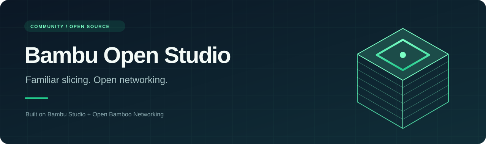

<p align="center">
  
</p>

<p align="center">
  <strong>The Bambu Studio workflow, with an open-source networking stack.</strong><br>
  A community fork for people who want to see, build, and change the code that talks to their printer.
</p>

<p align="center">
  <a href="docs/BUILDING.md"></a>
  <a href="docs/ARCHITECTURE.md"></a>
  <a href="https://github.com/Nickx777/bambu-open-studio/issues/new/choose"></a>
</p>

<p align="center">
  <a href="LICENSE"></a>
  <a href="docs/STATUS.md"></a>
  <a href="docs/STATUS.md#repository-checks"></a>
  <a href="https://github.com/ClusterM/open-bamboo-networking"></a>
</p>

---

## Why this fork exists

Bambu Studio already has an open-source slicer. Its optional networking plugin is a separate, proprietary piece. This fork closes that gap by bundling [Open Bamboo Networking](https://github.com/ClusterM/open-bamboo-networking) alongside the application and turning off the stock plugin's download, installation, and update paths.

The aim is straightforward: keep the slicing tools people already know, while making the printer connection code available to read and build. Multi-plate projects, supports, painting, printer profiles, and the G-code viewer stay upstream Bambu Studio features. The work here is the integration around networking and building a separate application.

**This is an early source release.** A Windows x64 build has booted with the open plugin loaded and discovery listening. That is a useful milestone, but it does not establish that every printer, camera, or cloud workflow works. There is no ready-to-install fork binary yet. See [the verification record](docs/STATUS.md) before building.

## What changes

| Area | In this fork |
| --- | --- |
| Slicing and project tools | Inherited from Bambu Studio. |
| Printer networking | Open Bamboo Networking, pinned to a specific source commit. |
| Plugin loading | Uses libraries next to the application executable, instead of plugin copies in the user profile. |
| Stock network plugin downloads | Disabled when `FULLY_OPEN_BUILD=ON`, which is the default. |
| Plugin OTA and camera helper downloads | Disabled in the open build. |
| Settings | The supplied Windows launcher gives this build its own profile. |
| Cloud features | Limited by the plugin, printer firmware, and available credentials. This is not a promise of full cloud parity. |

LAN discovery, telemetry, file transfer, printing, and camera support come from the open plugin. Their availability varies by printer and firmware; follow the [pinned plugin's instructions](https://github.com/ClusterM/open-bamboo-networking/blob/d8d8561cb5c5343963d0125e0eecefa0d644824d/README.md#two-ways-to-run) for LAN-only or Developer Mode. Cloud sign-in and preset syncing are distinct from sending commands to a cloud-paired printer. Go Live streaming and HMS photo snapshots are outside the implemented feature set.

## Get started

Clone the source **with its submodule**:

```sh
git clone --recurse-submodules https://github.com/Nickx777/bambu-open-studio.git
cd bambu-open-studio
```

Already cloned it? Run `git submodule update --init --recursive`.

On Windows, after installing the [build prerequisites](docs/BUILDING.md#windows-x64):

```powershell
$env:VCPKG_ROOT = 'C:\dev\vcpkg' # change this to your vcpkg checkout
.\build-fully-open.ps1 -BuildStudio
.\scripts\start-open-studio.ps1
```

The launcher stores settings under `.bambu-open/profile/` in this checkout and redirects the child application's `APPDATA` and `LOCALAPPDATA` there. Keep the fork in its own directory. It does not need to replace your installed Studio or install a plugin into that application's profile.

The build driver stages the open plugin, not a complete installer. Some runtime libraries and resources may still need staging after a development build. The [build guide](docs/BUILDING.md) covers that step, Windows toolchain pitfalls, Linux/macOS entry points, and camera registration.

> GitHub's automatic source ZIPs do not contain the plugin submodule. Use the recursive clone above for a complete source checkout.

## What “open” means here

The slicer source and replacement networking source are available under their existing AGPL licenses. The fork disables the paths that acquire Bambu Lab's closed networking and camera packages. It does **not** turn Windows or Microsoft's platform components into open-source software.

The Windows build still uses MSVC, the Windows SDK and runtime, and WebView2. Upstream also consumes a prebuilt FFmpeg package. The first local boot used a Mesa binary copied from the installed application and a libiconv runtime from the local toolchain. Those binaries are **not distributed in this repository**. [Build provenance](docs/STATUS.md#build-provenance) records those details so the source release does not overstate how the working local build was produced.

## Find your way around

| Guide | What you will find |
| --- | --- |
| [Building and running](docs/BUILDING.md) | Prerequisites, commands, runtime staging, and a separate profile. |
| [Architecture](docs/ARCHITECTURE.md) | The plugin loader, compile-time guards, version handshake, and source map. |
| [Status and provenance](docs/STATUS.md) | What was verified, what still needs testing, and build inputs. |
| [Troubleshooting and FAQ](docs/FAQ.md) | Missing DLLs, compiler mismatches, cameras, cloud limits, and updates. |
| [Contributing](CONTRIBUTING.md) | Useful first contributions and how to report a reproducible problem. |

## Next steps

- Reproduce the Windows build from a clean machine and make runtime staging repeatable.
- Exercise slicing, LAN printing, and camera workflows on real printers, with firmware versions recorded.
- Validate the integration on Linux and macOS, including application bundles.
- Produce fork-specific installers with dependency notices and complete corresponding source.

Small, reproducible fixes are welcome. If something fails, a clear log and the exact printer/firmware combination are more useful than a big feature list.

## Credits and license

This project builds on [Bambu Studio](https://github.com/bambulab/BambuStudio), [PrusaSlicer](https://github.com/prusa3d/PrusaSlicer), and [Slic3r](https://github.com/Slic3r/Slic3r). The replacement networking implementation is [Open Bamboo Networking](https://github.com/ClusterM/open-bamboo-networking), maintained by ClusterM and its contributors. This fork integrates their work; it does not claim authorship of the slicer or networking implementation.

The upstream history, copyright notices, and [AGPL-3.0 license](LICENSE) are preserved. The plugin retains its [own license](https://github.com/ClusterM/open-bamboo-networking/blob/d8d8561cb5c5343963d0125e0eecefa0d644824d/LICENSE), and dependencies retain their respective terms.

Bambu Open Studio is an independent community project, not an official Bambu Lab release. The application still contains upstream branding; “Bambu Open Studio” names this repository and its integration work.
