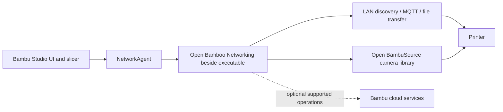

# Architecture

The fork keeps upstream slicing code and changes the boundary around the optional network libraries. The plugin source is a pinned git submodule, not a binary checked into the repository.

## Compile-time boundary

`FULLY_OPEN_BUILD` defaults to `ON` in `CMakeLists.txt`. The guarded code disables stock network package download, installation, profile plugin copying, background OTA sync, and the camera tools download path. The open plugin is built separately and must be staged beside the executable before use.

The loader skips the stock publisher certificate check in this mode, because an independently built plugin does not carry Bambu Lab's publisher signature. That is a loader policy change, not a claim that arbitrary DLLs are trusted. Users building or packaging the application should control which libraries they stage.

Turning the option off restores the upstream code paths. Such a build is outside this fork's open networking configuration.

## Source map

| File | Responsibility |
| --- | --- |
| `CMakeLists.txt` | Defines the open-build option and compile definition. |
| `src/slic3r/GUI/GUI_App.cpp` | Guards plugin download/install prompts and profile plugin copying. |
| `src/slic3r/Utils/NetworkAgent.cpp` | Chooses the bundled network and camera library locations. |
| `src/slic3r/Utils/PresetUpdater.cpp` | Disables proprietary plugin and camera helper sync. |
| `src/libslic3r/AppConfig.cpp` | Sets open-build defaults for networking and plugin updates. |
| `build-fully-open.ps1` / `build-fully-open.sh` | Build and stage the replacement plugin. |
| `scripts/start-open-studio.ps1` | Runs the Windows application with a separate profile. |
| `open-bamboo-networking/` | The upstream networking and camera implementation. |

## Version handshake

Studio compares the first eight characters of the plugin version against its expected version. The helpers read `SLIC3R_VERSION` from `version.inc` and pass it to the plugin configure step. Matching this string is necessary, but it does not prove all exports or behaviours are compatible with a new Studio release.

The published source pins Open Bamboo Networking to `d8d8561cb5c5343963d0125e0eecefa0d644824d`, matching the plugin revision in the recorded local boot. The earlier integration pinned v2.2.0; the working plugin came from a separate checkout at this newer revision. Updating the pin closes that provenance mismatch. The pinned revision is an interim upstream commit, not a new upstream stable release.

## Separate application, separate settings

The Windows launcher uses a dedicated data directory and child environment. The plugin loader ignores networking plugins in the normal Studio profile. This keeps routine settings and plugin selection separate when the checkout stays in its own directory.

The executable still uses upstream application identity and branding. Shared OS resources, notably DirectShow registration, are not separated by `--datadir`. The launcher is a convenience for local use, not an OS sandbox.
